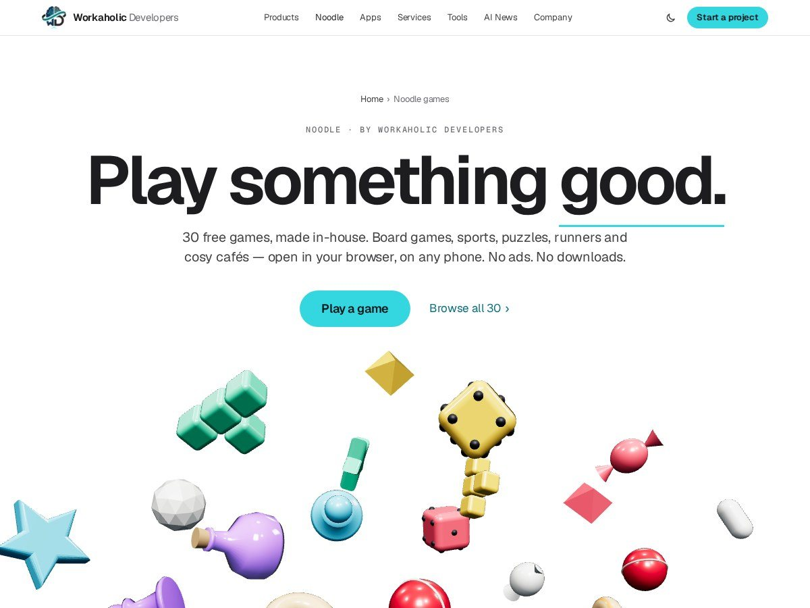
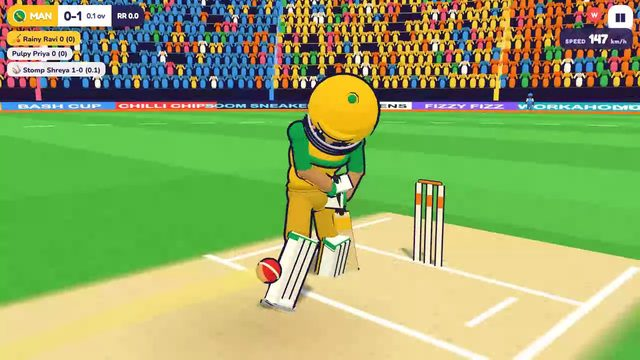
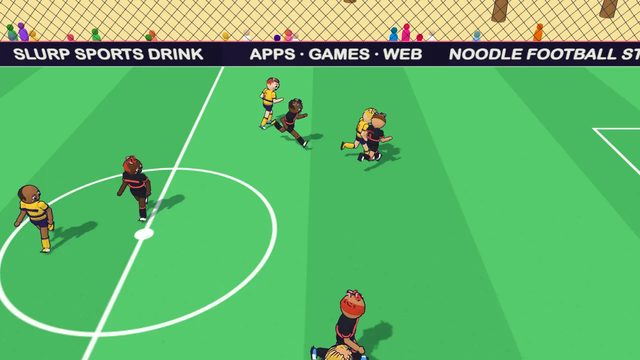
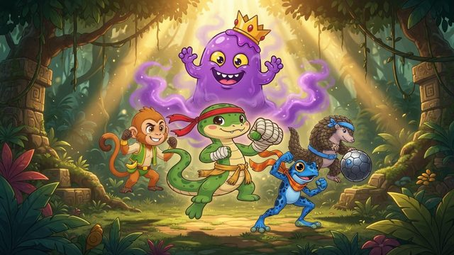
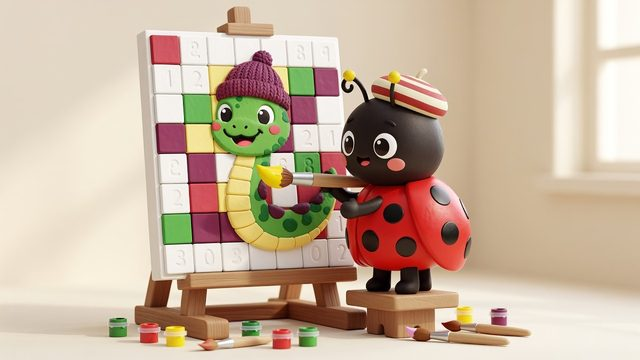

# Noodle games

**30 free games and 2 creative apps from Workaholic Developers, starring Noodle.** Board games, sports, puzzles, runners and cosy cafés that open in the browser on any phone or computer.

> This is a public showcase repository. It describes the product and links to it; the source code is private.

- All games: https://workaholicdevelopers.com/games

## Contents

- [Board and party](#board-and-party)
- [Sports](#sports)
- [Puzzle](#puzzle)
- [Brain and word](#brain-and-word)
- [Arcade and action](#arcade-and-action)
- [Cosy and creative](#cosy-and-creative)
- [Creative apps](#creative-apps)

## Board and party

### [Noodle Ludo](https://workaholicdevelopers.com/games/noodle-ludo)

*Classic Ludo for the whole family*

Play Ludo free in your browser: 10 themed Adventure boards against friendly bots, pass-and-play for 2–4 on one device, and private online rooms with friends. House rules, power cards, no ads, no tracking.

- 10 themed Adventure boards, from Sunny Meadow to the Volcano Finale
- Pass-and-play for 2–4 players on a single device
- Private online rooms, share a 6-letter code with friends
- Optional house rules and power cards

Board game, Family, Multiplayer · [Play free](https://ludo.workaholicdevelopers.com/play/) · [About](https://workaholicdevelopers.com/games/noodle-ludo)

### [Noodle Party](https://workaholicdevelopers.com/games/noodle-party-snakes-and-ladders)

*Snakes & Ladders with mini-games*

Snakes & Ladders reinvented: 8 magical boards, power cards and quick mini-games between turns. Play with family on one device or against friendly bots. Free in your browser, no ads.

- 8 magical boards with their own rules and hazards
- Power cards that swing the game on the last roll
- Quick mini-games between turns
- Smart bots that are fun rather than brutal

Board game, Family, Party · [Play free](https://party.workaholicdevelopers.com/play/) · [About](https://workaholicdevelopers.com/games/noodle-party-snakes-and-ladders)

## Sports

### [Noodle Cricket Bash](https://workaholicdevelopers.com/games/noodle-cricket-bash)

*Cartoon cricket with real rules*

Swipe to smash sixes, bowl yorkers and lift the Bash Cup. Cartoon cricket backed by a real rules engine, wides, no-balls, LBW and all, across five stadiums with live commentary. Free in your browser, no ads.

- A real cricket rules engine, wides, no-balls, LBW, run-outs
- Five stadiums including a floodlit night match
- Procedurally animated 3D players
- Live commentary that reacts to the game

Sports, Cricket, Arcade · [Play free](https://cricketbash.workaholicdevelopers.com/play/) · [About](https://workaholicdevelopers.com/games/noodle-cricket-bash)

### [Noodle's Big Swing](https://workaholicdevelopers.com/games/noodles-big-swing-baseball)

*Cartoon baseball with a story*

Perfect swings, towering home runs and a fun story: help Noodle go from the backyard sandlot to the Big Show. 60 levels, 6 ballparks and boss pitchers, free with no ads.

- 60 story levels across 6 ballparks, each ending with a boss pitcher
- Ball-cam home runs, fireworks and bat flips
- Home Run Derby and a Daily Challenge with a streak
- Unlock six bats, up to the legendary Golden Noodle

Sports, Baseball, Arcade · [Play free](https://baseball.workaholicdevelopers.com/play/) · [About](https://workaholicdevelopers.com/games/noodles-big-swing-baseball)

### [Noodle Football Stars](https://workaholicdevelopers.com/games/noodle-football-stars-soccer-game)

*Cartoon football with superstar moves*

Cartoon football with noodle superstars and special moves: an 80-mission story, four tournaments, 5-a-side cages and 11-a-side stadiums, and fair online matches. Free, no ads.

- 80 story missions on the Road to the Golden Bowl
- 5-a-side cages and full 11-a-side tournaments
- Fair online Quick Play and private rooms for friends
- Superstar special moves and live commentary

Sports, Football, Arcade · [Play free](https://football.workaholicdevelopers.com/play/) · [About](https://workaholicdevelopers.com/games/noodle-football-stars-soccer-game)

## Puzzle

### [Noodle's Potion Lab](https://workaholicdevelopers.com/games/noodles-potion-lab-color-sort)

*A cosy colour-sort puzzle*

Pour magical potions until every bottle holds a single colour. A free, ad-free colour-sort puzzle with 200 hand-tuned levels, the water-sort puzzle, done properly. Play instantly in your browser.

- 200 hand-tuned levels, every one is solvable
- Undo any pour, so you can think rather than guess
- No ads interrupting a puzzle you are mid-way through
- Relaxing by design: no timers, no lives, no energy meter

Puzzle, Logic, Casual · [Play free](https://potions.workaholicdevelopers.com/play/) · [About](https://workaholicdevelopers.com/games/noodles-potion-lab-color-sort)

### [Noodle's Sweet Shop](https://workaholicdevelopers.com/games/noodles-sweet-shop-match-3)

*A cosy match-3 puzzle*

Swap sweets, make matches of three and fill every customer's order before the moves run out. A free, ad-free match-3 puzzle with 200 levels across 10 worlds and a fresh Daily Order every day.

- 200 levels across 10 sweet-shop worlds
- A new Daily Order every day
- Order-based goals, not just score-chasing
- Free and ad-free, straight in the browser

Puzzle, Match 3, Casual · [Play free](https://sweets.workaholicdevelopers.com/play/) · [About](https://workaholicdevelopers.com/games/noodles-sweet-shop-match-3)

### [Noodle's Block Drop](https://workaholicdevelopers.com/games/noodles-block-drop-puzzle)

*A cosy falling-block puzzle*

Drop, spin and fit falling blocks to clear lines, collect gems and dig for treasure. A free, ad-free falling-block puzzle with 200 levels and an endless Marathon mode. Play instantly in your browser.

- 200 levels plus an endless Marathon mode
- Gems, bombs and rockets that change how you plan a drop
- Boosters for when a board gets away from you
- No ads, no timers pushing you into mistakes

Puzzle, Arcade, Casual · [Play free](https://blocks.workaholicdevelopers.com/play/) · [About](https://workaholicdevelopers.com/games/noodles-block-drop-puzzle)

### [Noodle Block Fit](https://workaholicdevelopers.com/games/noodle-block-fit-block-puzzle)

*Fit blocks, clear the quarry*

A free, kid-safe 8×8 block puzzle: drag stone blocks into the grid, clear rows and columns, collect gems, melt ice and free Noodle the snake. 104 goal levels in 8 quarries, plus a Daily Board, Classic and Relax modes.

- 104 solver-checked goal levels across 8 quarries
- Seven kinds of goal: gems, ice, glowing shapes, free Noodle and more
- Daily Board, endless Classic and a no-pressure Relax mode
- Colour-blind patterns and one-hand play

Puzzle, Block puzzle, Casual · [Play free](https://blockfit.workaholicdevelopers.com/play/) · [About](https://workaholicdevelopers.com/games/noodle-block-fit-block-puzzle)

### [Noodle Screw Loose](https://workaholicdevelopers.com/games/noodle-screw-loose-screw-puzzle)

*Unscrew planks, free friends*

A free screw-and-plank sorting puzzle for kids: tap screws into matching colour slots, drop the planks and open the cage with Rivet the beaver. 108 proven puzzles in 6 workshops, a Daily contraption, Zen mode and a dam to build.

- 108 solver-proven contraptions in 6 workshops
- Daily contraption and a no-fail Zen workshop
- Build Rivet's dam with every screw you free
- Colour-blind friendly shapes on every screw

Puzzle, Logic, Casual · [Play free](https://screwloose.workaholicdevelopers.com/play/) · [About](https://workaholicdevelopers.com/games/noodle-screw-loose-screw-puzzle)

### [Noodle Tile Trio](https://workaholicdevelopers.com/games/noodle-tile-trio-tile-match)

*Match 3 tiles, clear the pile*

A free, kid-safe tile-matching puzzle: tap free tiles into Mochi's tray and match three of a kind to clear the pile. 120 solver-proven puzzles across 6 cities, a Daily puzzle and a relaxing Zen mode.

- 120 solver-proven piles across 6 Indian cities
- Daily Puzzle and a no-fail Zen mode
- Undo, Shuffle and Pull-out earned from stars, never sold
- Objects differ by shape, so it works for colour-blind players

Puzzle, Tile matching, Casual · [Play free](https://tiletrio.workaholicdevelopers.com/play/) · [About](https://workaholicdevelopers.com/games/noodle-tile-trio-tile-match)

### [Noodle Cart Jam](https://workaholicdevelopers.com/games/noodle-cart-jam-traffic-puzzle)

*Clear the bazaar, cart by cart*

A free, kid-safe jam puzzle: help Tuk the auto-rickshaw clear a jammed Indian street market by tapping carts, scooters, cows and the wedding band truck out in as few moves as possible. 150 solver-proven levels, 6 bazaars, festival sets and a Daily Jam.

- 150 levels, each with a solver-proven minimum move count
- Diwali, Holi and Onam festival sets
- Daily Jam and a no-limit Relax mode
- Full English and Hindi menus

Puzzle, Logic, Casual · [Play free](https://cartjam.workaholicdevelopers.com/play/) · [About](https://workaholicdevelopers.com/games/noodle-cart-jam-traffic-puzzle)

### [Noodle Doodle Rescue](https://workaholicdevelopers.com/games/noodle-doodle-rescue-draw-puzzle)

*Draw a line, save the snake*

A free draw-a-line physics puzzle: draw one line to shield Noodle the snake from bees, falling pans, lava, cannonballs and zombie mice. 60 levels across 6 worlds, no ads.

- Your line becomes a real physics object
- 60 levels across 6 worlds, from Buzzy Garden to Space Noodle
- Every level solver-checked, with a free hint
- Unlock new crayon colours with stars

Puzzle, Physics, Casual · [Play free](https://draw.workaholicdevelopers.com/play/) · [About](https://workaholicdevelopers.com/games/noodle-doodle-rescue-draw-puzzle)

### [Noodle Merge Garden](https://workaholicdevelopers.com/games/noodle-merge-garden-merge-game)

*Merge seeds, grow a village*

A free, calm merge puzzle: help Fern the gardener merge seeds into sprouts, blossoms and grand trees and bring a dried-up village garden back to life over 12 chapters. 120 orders, a daily timed board and plant facts, with no ads and no energy timer.

- Ten plant families, each growing through eight stages
- 12 chapters and 120 robot-tested orders
- Walk around the village garden you restored
- No energy timer, daily timed board, plant fact cards

Puzzle, Merge, Casual · [Play free](https://mergegarden.workaholicdevelopers.com/play/) · [About](https://workaholicdevelopers.com/games/noodle-merge-garden-merge-game)

## Brain and word

### [Noodle Brain Daily](https://workaholicdevelopers.com/games/noodle-brain-daily-sudoku-puzzles)

*Four little puzzles a day*

A free daily puzzle pack with Neuro the glowing jellyfish: Sudoku, nonogram, logic grid and number cross, the same pack for everyone each day. Plus 440 solver-checked library puzzles, Zen play and a monthly report card.

- A new four-puzzle pack every day, the same for everyone
- 440 more puzzles, each proven to have exactly one answer
- Hints that explain the logical step instead of filling it in
- Monthly report card, dark mode and big text

Puzzle, Logic, Sudoku · [Play free](https://braindaily.workaholicdevelopers.com/play/) · [About](https://workaholicdevelopers.com/games/noodle-brain-daily-sudoku-puzzles)

### [Noodle Tricky Riddles](https://workaholicdevelopers.com/games/noodle-tricky-riddles-riddle-game)

*Silly scenes, sneaky answers*

A free, kid-safe riddle game in English and Hindi: 120 original trick questions set in chai stalls, gully cricket, autos, trains, school and shaadi. Tap, drag, hold and shake the scene to find the sneaky answer.

- 120 original riddles in 6 packs, in English and Hindi
- Interactive scenes: tap, drag, hold or shake to answer
- Hot-or-cold hints from Fib the chameleon
- Daily Riddle, Riddle Rush and shareable riddle cards

Puzzle, Riddles, Family · [Play free](https://trickyriddles.workaholicdevelopers.com/play/) · [About](https://workaholicdevelopers.com/games/noodle-tricky-riddles-riddle-game)

### [Noodle Word Nest](https://workaholicdevelopers.com/games/noodle-word-nest-word-connect)

*Connect letters, crack the daily*

A free, kid-safe word-connect game: swipe letters on Quill the owl's wheel to fill cosy crossword nests in English or Hinglish. Solve a Daily Crossword with streaks, relax in the Zen Nest and learn a word after every level.

- 156 solver-checked nests per language, in English or Hinglish
- Daily mini crossword with a streak calendar
- A learn-a-word card after every nest
- Big-text mode and a calm Zen Nest

Word, Puzzle, Crossword · [Play free](https://wordnest.workaholicdevelopers.com/play/) · [About](https://workaholicdevelopers.com/games/noodle-word-nest-word-connect)

## Arcade and action

### [Noodle Quest](https://workaholicdevelopers.com/games/noodle-quest-snake-game)

*A cosy snake adventure*

Swipe, munch and grow through 30 magical worlds in this cosy take on the classic snake game. Free, ad-free, playable instantly in your browser, no download, safe for kids.

- 30 hand-built worlds, each with its own twist
- Gentle difficulty curve, genuinely playable by kids
- No ads, no tracking, no in-app purchases
- Runs instantly in the browser, no download

Arcade, Puzzle, Casual · [Play free](https://snake.workaholicdevelopers.com/play/) · [About](https://workaholicdevelopers.com/games/noodle-quest-snake-game)

### [Noodle Rush: Zombie Dash](https://workaholicdevelopers.com/games/noodle-rush-zombie-dash)

*A spooky-cute 3D running game*

Noodle the snake rescues his Noodle Pals and leads them in a conga line through moonlit Pumpkin Hollow: spring over fences, burrow under arches, dodge wagons and stomp silly zombies. A free 3D running game, no ads.

- Free Noodle Pals and grow a conga line score multiplier
- Spring off your tail and burrow under arches
- Pals take the bump for you when you crash
- Power-ups: Super Slurp, Balloon Ride, Bubble Shield, Chilli Boost

Endless runner, Action, Arcade · [Play free](https://run.workaholicdevelopers.com/play/) · [About](https://workaholicdevelopers.com/games/noodle-rush-zombie-dash)

### [Noodle's Maze Munch](https://workaholicdevelopers.com/games/noodles-maze-munch-maze-game)

*Munch seeds, dodge the gnomes*

A free maze-chase game for kids: steer Noodle the snake through 120 hedge mazes in 8 gardens, munch glowing seeds, outwit the garden gnomes and bonk the Gnome King's crown. Daily Maze, Endless Hedge and 24 stickers, no ads.

- 120 robot-tested mazes across 8 gardens
- A Gnome King boss at the end of every garden
- Four gnome personalities and three power-ups
- Daily Maze, Endless Hedge and 24 stickers

Arcade, Maze, Casual · [Play free](https://maze.workaholicdevelopers.com/play/) · [About](https://workaholicdevelopers.com/games/noodles-maze-munch-maze-game)

### [Noodle's Critter Canyon](https://workaholicdevelopers.com/games/noodles-critter-canyon-platformer)

*A wild-west posse platformer*

A free wild-west platformer: Sheriff Noodle and a posse of critters round up Rascal the raccoon's outlaw gang across 60 levels and 6 boss fights. Play in cartoon or 16-bit retro mode, no ads.

- Swap between four critters, each with their own ability
- 60 levels in 6 worlds with 6 big boss showdowns
- Mine carts and runaway train-roof chases
- Flip to a 16-bit retro look with one switch

Platformer, Action, Adventure · [Play free](https://canyon.workaholicdevelopers.com/play/) · [About](https://workaholicdevelopers.com/games/noodles-critter-canyon-platformer)

### [Noodle Jump](https://workaholicdevelopers.com/games/noodle-jump-platformer)

*Hop and swing through Kitchen Kingdom*

A free, colourful platformer for kids: coil-jump, stretch and swing Noodle the snake through 7 tasty worlds, bop grumpy peppers, find star cookies, beat the bosses and take on the Daily Dash. No ads.

- 42 levels and 7 boss fights across Kitchen Kingdom
- Coil-jump, stretch and swing on fork hooks
- Magic sauces: chili dash, pesto glide, honey wall-jumps
- Helper mode for little players, plus a Daily Dash

Platformer, Adventure, Casual · [Play free](https://jump.workaholicdevelopers.com/play/) · [About](https://workaholicdevelopers.com/games/noodle-jump-platformer)

### [Noodle Zoom: Coil Rush](https://workaholicdevelopers.com/games/noodle-zoom-speed-platformer)

*A loop-and-spring speed platformer*

A free, super-fast platformer: Noodle coils into a spinning wheel to race through loops, rails and springs across 8 zones, beat Professor Spork's 8 machines and free the Noodle Pals. No ads.

- 8 zones, 24 acts and 8 boss machines
- Coil Jump, Coil Roll, Rev Coil and Tail Whip moves
- 72 hidden Noodle Pals and Spice Gem bonus stages
- Cartoon or 16-bit retro look

Platformer, Action, Arcade · [Play free](https://zoom.workaholicdevelopers.com/play/) · [About](https://workaholicdevelopers.com/games/noodle-zoom-speed-platformer)

### [Noodle: King of the Jungle](https://workaholicdevelopers.com/games/noodle-king-of-the-jungle-fighting-game)

*Wholesome arcade fighting*

A free, wholesome arcade fighting game: free the jungle's champions from the Grumble Mist with combos, specials and the Jungle Roar. Learn real animal facts in voiced story cinematics.

- Six animal champions across 36 levels
- Combos, grab-and-slam moves and four special powers each
- Voiced motion-comic story cinematics
- Jungle Journal pages with real animal facts

Fighting, Arcade, Action · [Play free](https://jungle.workaholicdevelopers.com/play/) · [About](https://workaholicdevelopers.com/games/noodle-king-of-the-jungle-fighting-game)

### [Noodle Street Ninjas](https://workaholicdevelopers.com/games/noodle-street-ninjas-beat-em-up)

*Cartoon arcade brawler*

A free cartoon arcade brawler: team up with Noodle, Kiki, Tank and Bloop, clean the Gloop gang off the rooftops, win Dojo Duels and fight through tournaments. No ads.

- Four ninjas who each play differently
- 54-stage story with six giant bosses
- Co-op with a CPU buddy, local controller or online room code
- Dojo Duels, tournaments and a Survival Gauntlet

Beat 'em up, Action, Arcade · [Play free](https://ninjas.workaholicdevelopers.com/play/) · [About](https://workaholicdevelopers.com/games/noodle-street-ninjas-beat-em-up)

### [Noodle Strike Force](https://workaholicdevelopers.com/games/noodle-strike-force-run-and-gun)

*Run, jump and blast the goo*

A free side-scrolling run-and-gun adventure: Noodle the commando snake blasts goo aliens, grabs wild weapons, frees friends from cages and takes on giant bosses. No ads.

- Six weapons to grab and upgrade in the Armory
- Four worlds and 40 missions, each ending in a giant boss
- Secret Retro Rift bonus stages
- Touch, keyboard or game-controller play

Action, Run and gun, Arcade · [Play free](https://strike.workaholicdevelopers.com/play/) · [About](https://workaholicdevelopers.com/games/noodle-strike-force-run-and-gun)

### [Noodle Getaway](https://workaholicdevelopers.com/games/noodle-getaway-driving-game)

*Cartoon heist city driving*

A cartoon open-city driving game: steal back the treasures Baron Bling stole, shake off the Bulldog Patrol and clear Dash the raccoon's name. No weapons, nobody gets hurt.

- A whole cartoon island city with 4 districts to drift through
- Story missions with three stars to earn
- Up to five sirens of Bulldog Patrol heat
- 20 hidden Golden Noodles to find

Driving, Action, Open world · [About](https://workaholicdevelopers.com/games/noodle-getaway-driving-game) · On TestFlight now

## Cosy and creative

### [Noodle's Pet Café](https://workaholicdevelopers.com/games/noodles-pet-cafe)

*A cosy café time-management game*

Seat adorable pets, grab treats from the counter and serve every table with Noodle the snake waiter. A free, ad-free café time-management game: 60 days across 5 cafés, plus a new Daily Rush every day.

- 60 days across 5 very different cafés
- A new Daily Rush challenge every day
- Upgrades that genuinely change how you play a shift
- Cute enough for kids, tight enough for grown-ups

Time management, Simulation, Casual · [Play free](https://cafe.workaholicdevelopers.com/play/) · [About](https://workaholicdevelopers.com/games/noodles-pet-cafe)

### [Noodle Chai Stall](https://workaholicdevelopers.com/games/noodle-chai-stall-cooking-game)

*Serve chai, grow your dhaba*

A free, kid-safe street-food stall game: walk Tawa the pressure cooker around a busy Indian stall serving chai, samosas, vada pav, dosa, pani puri and jalebi, then hire helpers and grow to a train-station canteen. 100 goals, a Daily Rush, chill mode and real recipe cards.

- Four stops from roadside stall to station canteen, 100 goals
- Six Indian street foods, each with its own station
- Real family recipe cards unlocked by goals
- Daily Rush, chill mode and English/Hindi menus

Time management, Simulation, Casual · [Play free](https://chaistall.workaholicdevelopers.com/play/) · [About](https://workaholicdevelopers.com/games/noodle-chai-stall-cooking-game)

### [Noodle Pixel Paint](https://workaholicdevelopers.com/games/noodle-pixel-paint-color-by-number)

*Calm colour-by-number pixel art*

A free, calm colour-by-number pixel art game: paint 191 pictures in 10 albums with Dot the ladybird, from the Noodle heroes to Jaipur bazaars, rangoli and mandalas. A new picture every day, free paint and paint-your-own-photo, no ads.

- 191 pictures across 10 albums
- Picture of the day, same for everyone
- Turn your own photo into a paint-by-number on-device
- Time-lapse playback you can save as a GIF

Colouring, Creative, Casual · [Play free](https://pixelpaint.workaholicdevelopers.com/play/) · [About](https://workaholicdevelopers.com/games/noodle-pixel-paint-color-by-number)

## Creative apps

### [Noodle Cam](https://workaholicdevelopers.com/games/noodle-cam-face-filters)

*Funny face filters & stickers*

A free, fun face-filter camera: puppy ears, rainbow mouth, dragon fire breath, big eyes, 32 colour filters, magic backgrounds and stickers. Everything runs on your own device, no photo ever leaves it.

- 72 live face lenses that react to your mouth, smile and blinks
- Face swap, hand-magic gestures and a voice changer
- Cartoon Me, Old Me and Baby Me morph lenses
- Runs entirely on your device, nothing is uploaded

[Play free](https://cam.workaholicdevelopers.com/play/) · [About](https://workaholicdevelopers.com/games/noodle-cam-face-filters)

### [Noodle Cut](https://workaholicdevelopers.com/games/noodle-cut-video-editor)

*A friendly iPhone & iPad video editor*

A friendly video editor for iPhone and iPad: templates, auto captions, music, transitions and 4K export with no watermark. Built for people who want a finished video in minutes, not a timeline to learn.

- Templates that get you to a finished video fast
- Automatic captions you can restyle
- Music, transitions and simple trimming
- 4K export with no watermark

[About](https://workaholicdevelopers.com/games/noodle-cut-video-editor) · Coming soon

---

Built by [Workaholic Developers](https://workaholicdevelopers.com), a software company with teams in India and Canada. Questions or a project in mind: info@workaholicdevelopers.com
